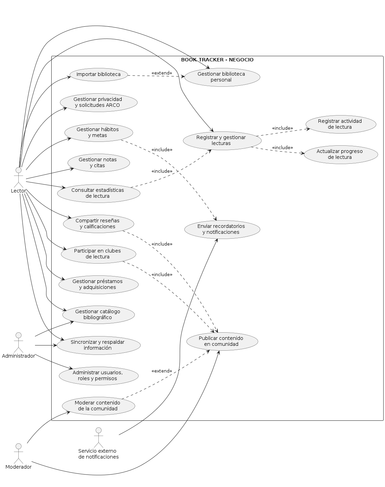
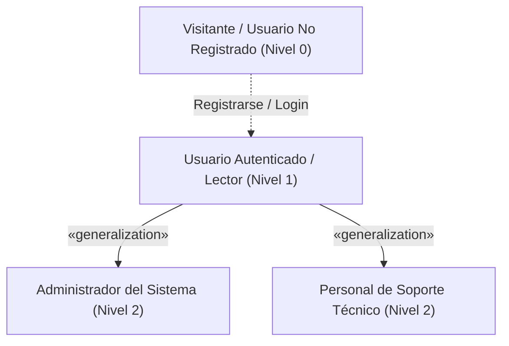
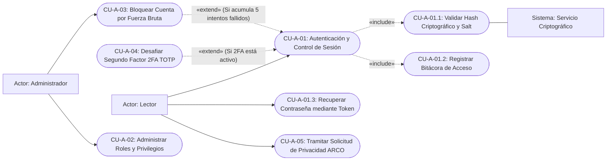
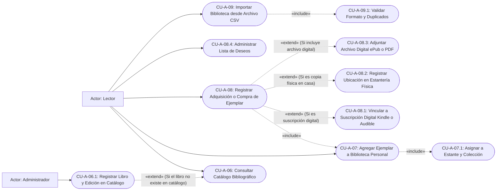
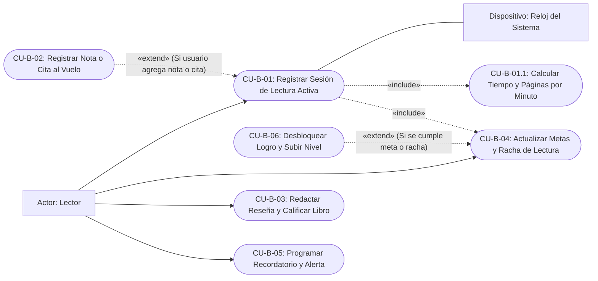
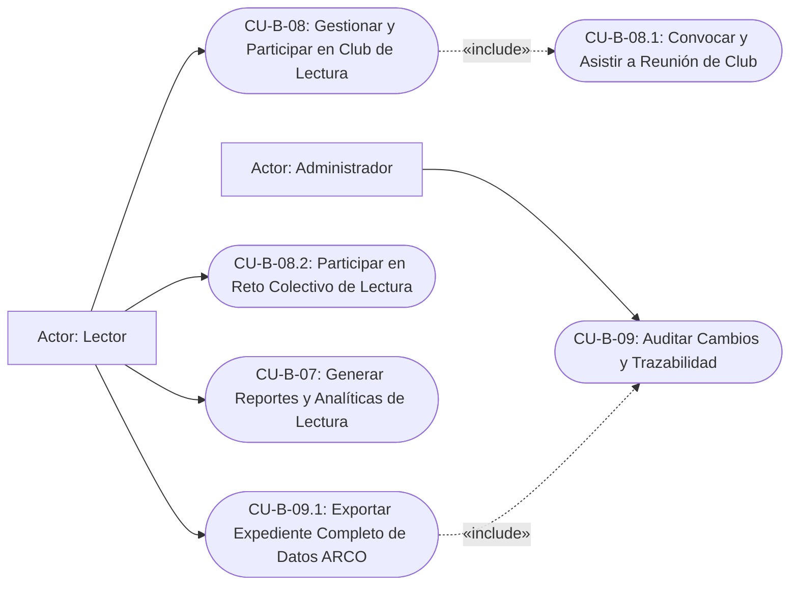
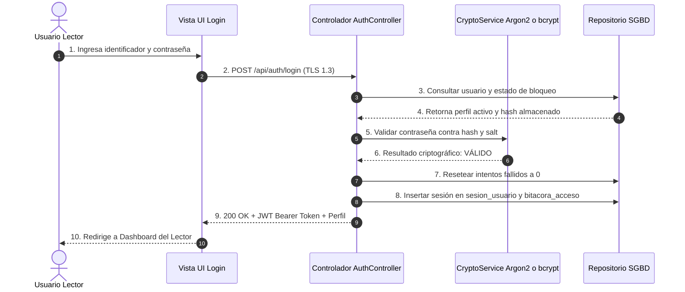

# 1.2 Modelado del Negocio y Casos de Uso

> **Proyecto Integrador Multidisciplinario V — TecNM / Instituto Tecnológico Superior de Monclova**  
> **Asignatura:** Análisis y Modelado de Sistemas de Información (AMSI — IFE-1005)  
> **Sistema:** *Book Tracker* — Plataforma Integral de Gestión de Lectura, Biblioteca Personal, Hábitos y Analítica  
> **Autores:** Estudiante A (Seguridad y Biblioteca) · Estudiante B (Lectura, Hábitos y Social)  
> **Capítulo de Memoria Técnica:** Capítulo II, Sección 2.2 y 2.3  
> **Criterio Evaluado:** Criterio 1.2 de la Rúbrica Oficial (25% de la ponderación total de AMSI)

---

## 1. Fundamentos Metodológicos y Notación UML 2.5

El presente modelo traduce los 18 submódulos funcionales y el catálogo de requerimientos computacionales de *Book Tracker* en especificaciones formales orientadas a objetos utilizando la notación estándar **UML 2.5 (Unified Modeling Language)**. 

### 1.1 Jerarquía y Generalización de Actores del Sistema

* **Visitante / Usuario No Registrado (Nivel 0):** Usuario que accede a las interfaces públicas del sistema (registro de cuenta, consulta del aviso de privacidad y login).
* **Usuario Autenticado / Lector (Nivel 1):** Actor base del dominio. Cuenta con una sesión activa validada criptográficamente. Hereda capacidades para gestionar su biblioteca personal, registrar cronómetros de lectura, interactuar en clubes, configurar recordatorios y ejercer sus derechos ARCO.
* **Administrador del Sistema (Nivel 2):** Especialización del Usuario Autenticado con privilegios elevados. Responsable de la asignación de roles, auditoría de accesos globales, parametrización de políticas de contraseña y catálogo bibliográfico maestro.
* **Personal de Soporte Técnico (Nivel 2):** Especialización orientada a la resolución de incidencias, desbloqueo asistido de cuentas, atención primaria a solicitudes ARCO y mantenimiento preventivo.
* **Actores Secundarios / Sistemas Externos:**
  * `«system» Motor Criptográfico`: Subsistema de cálculo de funciones hash (`bcrypt`/`Argon2`), salting y validación de tokens JWT.
  * `«system» SGBD Multi-Motor (SQL Server / PostgreSQL)`: Gestores de bases de datos relacionales encargados de la persistencia de transacciones e integridad referencial.
  * `«system» Servicio de Mensajería SMTP/SMS`: Plataforma para despacho de correos de confirmación, códigos OTP de segundo factor (2FA) y alertas preventivas de seguridad.

---

### 1.2 Convenciones de Sintaxis de Casos de Uso Aplicadas

1. **Relación de Inclusión (`«include»`):** Representa un comportamiento que se ejecuta **obligatoriamente** como parte del caso de uso base. El flujo principal del caso base no puede culminar exitosamente sin la ejecución integral del caso incluido.
2. **Relación de Extensión (`«extend»`):** Modela comportamientos opcionales o excepcionales que se incorporan al caso base **únicamente si se cumple una condición lógica específica** definida en un *Punto de Extensión (Extension Point)* formal.
3. **Generalización de Casos de Uso:** Relación de herencia semántica donde un caso de uso hijo hereda la estructura y el objetivo del caso padre, especializando su comportamiento técnico o su mecanismo de ejecución.

---

## 2. Diagramas de Casos de Uso del Sistema

### 2.1 Diagrama del Núcleo de Seguridad y Control de Acceso (Submódulos A1, A2, A3, A4, A5)
*Submódulo de Gobernanza y Ciberseguridad — Responsable: Estudiante A*

---

### 2.2 Diagrama de Gestión Bibliográfica, Copias, Suscripciones y Wishlist (Submódulos A6, A7, A8, A9)
*Submódulo de Catálogo, Biblioteca Personal y Formatos Digitales — Responsable: Estudiante A*

---

### 2.3 Diagrama de Hábitos de Lectura, Sesiones y Gamificación (Submódulos B1, B2, B3, B4, B5, B6)
*Submódulo de Productividad y Hábitos — Responsable: Estudiante B*

---

### 2.4 Diagrama de Comunidad Social, Estadísticas y Auditoría (Submódulos B7, B8, B9)
*Submódulo Social y Gobernanza de Datos — Responsable: Estudiante B*

---

## 3. Especificación Textual Expandida de Casos de Uso

---

### Caso de Uso Obligatorio de la Rúbrica: CU-A-01
#### Autenticación de Usuario y Control de Sesión (Login Seguro)

| Elemento | Especificación Formal |
| :--- | :--- |
| **Identificador** | **CU-A-01** (Obligatorio según Criterio 1.2 y 1.3 de la Rúbrica) |
| **Nombre** | **Autenticación de Usuario, Verificación Criptográfica y Control de Sesión** |
| **Módulo / Autor** | Submódulo A3 (Sesiones y Auditoría de Acceso) · **Estudiante A** |
| **Actores Principales** | Usuario No Autenticado (Visitante / Lector / Administrador) |
| **Actores Secundarios** | `«system» CryptoService`, `«system» SGBD Repository`, `«system» MailService` |
| **Clasificación** | Caso de Uso Primario del Sistema / Seguridad Crítica |
| **Requisitos Asociados** | `RF-A-01`, `RF-A-03`, `RF-A-04`, `RF-A-05`, `RF-A-11`, `RF-A-12`, `RF-A-13`, `RF-A-17`, `RNF-A-01`, `RNF-A-02` |

#### Descripción
El caso de uso modela el procedimiento mediante el cual un usuario introduce sus credenciales (`username`/`email` y contraseña en texto claro temporal) en la interfaz gráfica. El sistema transmite la información bajo capa segura TLS 1.3, valida el estado de la cuenta, delega la verificación criptográfica con salting al servicio de derivación de claves (`bcrypt` / `Argon2`), aplica políticas de control de concurrencia e intentos fallidos, y expide un token de sesión criptográfico (JWT/Bearer), registrando de forma inmutable cada intento en la bitácora de auditoría.

#### Precondiciones
1. El canal de comunicación cliente-servidor opera bajo protocolo cifrado **HTTPS con TLS 1.3**.
2. El usuario debe existir en la entidad `usuario` y su registro debe tener la bandera `activo = TRUE`.
3. La cuenta del usuario no debe presentar un bloqueo vigente en la entidad `bloqueo_cuenta`.

#### Poscondiciones
* **Poscondición de Éxito:** Se genera una tupla en `sesion_usuario` con token firmado, fecha de expiración y contexto de navegación; se registra el evento exitoso en `bitacora_acceso` con `resultado = 'EXITOSO'`; se resetea el contador de intentos fallidos a cero; el usuario es redirigido a su panel de control.
* **Poscondición de Fallo:** Se genera un registro inmutable en `bitacora_acceso` con `resultado = 'FALLIDO'`, IP de origen y agente de usuario; se incrementa el contador de fallos; las credenciales no son almacenadas ni volcadas en memoria.

---

#### Flujo Principal de Eventos (Camino Feliz)

1. El usuario accede a la interfaz de autenticación e ingresa su correo electrónico o nombre de usuario y su contraseña secreta.
2. La Vista empaqueta los datos en una solicitud HTTP POST cifrada bajo TLS 1.3 hacia el `AuthController`.
3. El `AuthController` sanitiza las entradas y consulta en el Repositorio la existencia del usuario en la tabla `usuario`.
4. El Repositorio confirma que el usuario existe, se encuentra activo (`activo = 1`) y verifica en `bloqueo_cuenta` que no existe ningún bloqueo temporal activo.
5. El Repositorio extrae el hash almacenado en `credencial_usuario` (algoritmo, salt y hash digest).
6. El `AuthController` invoca al `CryptoService` enviando la contraseña candidata en memoria y el hash registrado.
7. El `CryptoService` ejecuta la función de derivación de claves (`bcrypt.compare` o `Argon2id.verify`) con tiempo de ejecución constante para mitigar ataques de temporización (*timing attacks*).
8. El `CryptoService` dictamina que la contraseña coincide plenamente con el hash almacenado.
9. El `AuthController` incluye el caso de uso **CU-A-01.2: Registrar Bitácora de Acceso**, insertando una tupla en `bitacora_acceso` (`id_usuario`, `fecha_hora`, `ip_origen`, `user_agent`, `resultado = 'EXITOSO'`).
10. El sistema evalúa los puntos de extensión:
    * **Punto de Extensión 1 (2FA):** Si el usuario tiene habilitado el segundo factor (`tiene_2fa = TRUE`), se ejecuta el flujo alterno **A1**.
11. El sistema restablece el contador de intentos fallidos en `credencial_usuario` a cero.
12. El `AuthController` crea la sesión en `sesion_usuario` y genera un JSON Web Token (JWT) firmado con clave privada asimétrica, con tiempo de expiración definido y *claims* de roles y permisos.
13. El sistema responde con código HTTP 200 (OK), almacena el token en una cookie segura (`HttpOnly`, `SameSite=Strict`, `Secure`) y redirige al usuario a su panel de control.

---

#### Flujos Alternos

##### Flujo Alterno A1: Autenticación de Dos Factores Habilitada (Punto de Extensión 1)
* **Condición de activación:** El usuario tiene configurado un método 2FA en la tabla `metodo_2fa`.
1. En el paso 10 del flujo principal, el sistema detecta que el segundo factor está activo.
2. El sistema suspende la emisión del JWT completo y emite un token provisional de desafío (`pre-auth-token`) de un solo uso con vigencia de 5 minutos.
3. La interfaz presenta la pantalla de **Desafío 2FA (Código OTP / TOTP)**.
4. El usuario introduce el código numérico de 6 dígitos generado por su aplicación de autenticación (Google Authenticator / Authy) o un código de respaldo de `codigo_respaldo_2fa`.
5. El sistema valida el código TOTP contra la semilla simétrica resguardada.
6. Si el código es correcto:
   * Si se utilizó un código de respaldo, se marca como utilizado en `codigo_respaldo_2fa` con fecha y hora.
   * El sistema continúa en el paso 11 del flujo principal (emisión de sesión final y redirección).
7. Si el código es incorrecto, se ejecuta el escenario de excepción **E1**.

##### Flujo Alterno A2: Política de Contraseña Expirada (Submódulo A1)
* **Condición de activación:** La fecha actual excede el periodo de vigencia configurado en `politica_contrasena` desde la última modificación en `historial_credencial`.
1. Tras el paso 8 del flujo principal, el sistema calcula la antigüedad de la credencial activa.
2. Si la vigencia ha caducado, el sistema restringe el alcance del token de sesión al ámbito de cambio de credencial.
3. La interfaz notifica al usuario: *"Su contraseña ha vencido por directiva de seguridad. Debe actualizarla para continuar"*.
4. Se invoca el caso de uso subordinado **CU-A-01.4: Actualizar Contraseña Expirada**, validando que la nueva contraseña cumpla la complejidad mínima y no coincida con las últimas 5 registradas en `historial_credencial`.

---

#### Flujos de Excepción

##### Escenario E1: Credenciales Inválidas (Hash no coincide)
1. En el paso 8 del flujo principal, el `CryptoService` dictamina que la contraseña provista no corresponde con el hash resguardado.
2. El `AuthController` registra el evento en `bitacora_acceso` con `resultado = 'FALLIDO_PASSWORD'`.
3. El sistema incrementa en 1 el campo `intentos_fallidos` en `credencial_usuario`.
4. El sistema evalúa: si `intentos_fallidos >= 5`, se deriva inmediatamente al **Escenario E2**.
5. Si no se alcanza el límite de bloqueo, el sistema responde con HTTP 401 (Unauthorized) y el mensaje genérico: *"Credenciales de acceso incorrectas"*. (Se prohíbe revelar si el error fue el usuario o la contraseña para prevenir enumeración de usuarios).

##### Escenario E2: Bloqueo de Cuenta por Fuerza Bruta (Punto de Extensión 2)
1. Al acumularse 5 intentos fallidos consecutivos, el sistema invoca la regla de contención.
2. El sistema inserta una tupla en `bloqueo_cuenta` registrando: `id_usuario`, `fecha_inicio = NOW()`, `fecha_fin = NOW() + 30 MIN`, `motivo = 'EXCESO_INTENTOS_FALLIDOS'`.
3. Se registra el incidente en `bitacora_acceso` como `resultado = 'CUENTA_BLOQUEADA'`.
4. El `MailService` despacha un correo de alerta a la dirección registrada notificando el bloqueo temporal y las coordenadas de red del intento (IP y fecha).
5. La interfaz presenta el mensaje: *"Cuenta bloqueada temporalmente por motivos de seguridad debido a múltiples intentos fallidos. Intente nuevamente en 30 minutos o recupere su acceso"*.

##### Escenario E3: Cuenta Desactivada o con Baja Lógica
1. En el paso 4 del flujo principal, el sistema detecta que el campo `activo = 0`.
2. Se rechaza la autenticación sin ejecutar el `CryptoService` para evitar consumo innecesario de CPU.
3. Se registra en `bitacora_acceso` como `resultado = 'CUENTA_INACTIVA'`.
4. El sistema responde con HTTP 403 (Forbidden) notificando al usuario que debe comunicarse con Soporte Técnico.

##### Escenario E4: Pérdida de Conectividad con la Base de Datos
1. Si en los pasos 3 u 8 el controlador experimenta un error de socket o timeout con el SGBD, la transacción entra en rollback.
2. Se registra la falla en los logs del sistema operativo.
3. Se devuelve un código HTTP 503 (Service Unavailable) con el mensaje: *"Servicio de autenticación no disponible temporalmente. Intente en unos momentos"*.

---

### Caso de Uso CU-A-07
#### Organizar Ejemplar en Biblioteca Personal y Asignar Estantes

| Elemento | Especificación Formal |
| :--- | :--- |
| **Identificador** | **CU-A-07** |
| **Nombre** | **Organizar Ejemplar en Biblioteca Personal y Asignar a Estantes** |
| **Módulo / Autor** | Submódulo A7 (Biblioteca Personal) · **Estudiante A** |
| **Actores Principales** | Usuario Autenticado (Lector) |
| **Actores Secundarios** | `«system» SGBD Repository` |
| **Clasificación** | Caso de Uso Transaccional del Dominio |
| **Requisitos Asociados** | `RF-A-35`, `RF-A-36`, `RF-A-37`, `RF-A-38`, `RF-A-39`, `RF-A-40` |

* **Precondiciones:** El lector tiene sesión activa y el libro existe en el catálogo maestro (`libro` / `edicion`).
* **Poscondiciones:** Se crea el registro en `ejemplar_usuario` asociado al usuario; se vincula al estado de lectura (`Leyendo`, `Por Leer`, `Leído`, `Abandonado`); se actualiza el índice de `estante_ejemplar`.
* **Flujo Principal:**
  1. El lector selecciona la opción "Agregar a mi biblioteca" desde la ficha de un libro.
  2. El sistema solicita el estado de lectura inicial, estante destino (ej. "Favoritos", "Pendientes 2026"), formato (físico, digital, audiolibro) y etiquetas personalizadas.
  3. El lector confirma los parámetros.
  4. El sistema incluye `«include»` la validación de integridad referencial verificando que el estante pertenezca al mismo usuario autenticado.
  5. El sistema persiste la tupla en `ejemplar_usuario` y los enlaces relacionales en `estante_ejemplar` y `etiqueta_ejemplar`.
  6. El sistema confirma la adición exitosa y actualiza la vista de la biblioteca.
* **Flujos Alternos:**
  * **A1 (Estante nuevo):** El lector no encuentra un estante adecuado; el caso se extiende `«extend»` permitiendo crear una nueva entidad `estante` en caliente sin abandonar el flujo.
* **Excepciones:**
  * **E1 (Ejemplar duplicado):** Si el usuario ya posee dicho ejemplar en el mismo formato, el sistema advierte la existencia y solicita confirmación de si desea registrar una segunda copia física.

---

### Caso de Uso CU-B-01
#### Registrar Sesión de Lectura Activa con Cronómetro

| Elemento | Especificación Formal |
| :--- | :--- |
| **Identificador** | **CU-B-01** |
| **Nombre** | **Registrar Sesión de Lectura Activa con Cronómetro y Cálculo de Métricas** |
| **Módulo / Autor** | Submódulo B1 (Sesiones de Lectura y Cronómetro) · **Estudiante B** |
| **Actores Principales** | Usuario Autenticado (Lector) |
| **Actores Secundarios** | `«hardware» Reloj del Cliente`, `«system» SGBD Repository` |
| **Clasificación** | Caso de Uso Transaccional Crítico de Negocio |
| **Requisitos Asociados** | `RF-B-01`, `RF-B-02`, `RF-B-03`, `RF-B-04`, `RF-B-05`, `RF-B-06` |

* **Precondiciones:** El lector tiene un ejemplar en estado "Leyendo" o "Por leer" en su biblioteca personal.
* **Poscondiciones:** Se registra la sesión en `sesion_lectura` con hora inicio, fin y duración neta; se actualiza el campo `pagina_actual` en `progreso_lectura`; se recalculan los hábitos diarios en `registro_habito` y la racha en `racha_lectura`.
* **Flujo Principal:**
  1. El lector abre la pantalla del cronómetro, selecciona el ejemplar y presiona "Iniciar Lectura".
  2. El sistema almacena la marca de tiempo de inicio (`inicio_sesion = NOW()`).
  3. Durante la lectura, el usuario puede presionar "Pausar", generando una tupla en `pausa_sesion_lectura` con motivo y duración.
  4. Al concluir la lectura, el usuario presiona "Finalizar Sesión", indicando la página final alcanzada y su nivel de concentración o lugar de lectura (`lugar_lectura`).
  5. El sistema incluye `«include»` el cálculo de métricas:
     * Páginas Leídas = Página Final - Página Inicial.
     * Tiempo Neto (minutos) = Tiempo Total - Suma de Pausas.
     * Velocidad = Páginas Leídas / Tiempo Neto (páginas por minuto).
  6. El sistema incluye `«include»` la actualización del progreso porcentual del libro en `progreso_lectura`.
  7. El sistema incluye `«include»` la sincronización con el submódulo de metas (CU-B-04).
  8. El caso de uso se extiende `«extend»` a **CU-B-06 (Desbloquear Logro)** si el tiempo o páginas leídas alcanzan una meta de gamificación.
  9. Se muestra un resumen visual de la sesión al usuario.
* **Flujos Alternos:**
  * **A1 (Cita al vuelo):** Mientras el cronómetro corre, el lector presiona "Añadir Cita/Nota"; el caso se extiende `«extend»` hacia **CU-B-02**, guardando la cita asociada a la página actual sin detener el cronómetro.
* **Excepciones:**
  * **E1 (Página final menor a página inicial):** El sistema rechaza el valor, solicita corrección o confirmación en caso de que se trate de una relectura del libro.

---

### Caso de Uso CU-B-04
#### Establecer y Evaluar Metas, Hábitos y Racha de Lectura

| Elemento | Especificación Formal |
| :--- | :--- |
| **Identificador** | **CU-B-04** |
| **Nombre** | **Establecer y Monitorear Metas, Hábitos y Racha de Lectura** |
| **Módulo / Autor** | Submódulo B4 (Metas y Hábitos) · **Estudiante B** |
| **Actores Principales** | Usuario Autenticado (Lector) |
| **Actores Secundarios** | `«system» SGBD Repository`, `«system» NotificationService` |
| **Clasificación** | Caso de Uso de Analítica y Hábitos |
| **Requisitos Asociados** | `RF-B-18`, `RF-B-19`, `RF-B-20`, `RF-B-21`, `RF-B-22`, `RF-B-23` |

* **Precondiciones:** Lector autenticado.
* **Poscondiciones:** Se crea o actualiza `meta_lectura` y `progreso_meta`; se evalúa la continuidad de `racha_lectura`.
* **Flujo Principal:**
  1. El lector define una meta (anual por número de libros, o diaria por minutos/páginas) en `tipo_meta`.
  2. El sistema registra la meta en `meta_lectura` vinculada a su periodo de vigencia.
  3. Tras cada sesión de lectura (CU-B-01), el sistema evalúa si se cubrió el compromiso del día.
  4. Si el usuario leyó al menos los minutos/páginas configurados, el sistema extiende la entidad `racha_lectura` incrementando `dias_consecutivos` en 1 y actualizando `fecha_ultimo_dia`.
  5. Si el incremento de racha supera el récord histórico del usuario, se actualiza `racha_maxima`.
  6. El sistema notifica al usuario su progreso actualizado.
* **Flujos Alternos:**
  * **A1 (Congelamiento de racha / Día de descanso):** El usuario activa un "comodín de racha" previamente obtenido mediante logros; el sistema preserva la racha sin penalización a pesar de la ausencia de lectura.
* **Excepciones:**
  * **E1 (Ruptura de racha):** El usuario no registra lectura dentro de la ventana de 24 horas y no tiene comodines; el sistema reinicia `dias_consecutivos = 1` en su siguiente lectura y archiva la racha anterior.

---

### Caso de Uso CU-A-05
#### Ejercicio de Derechos ARCO y Gestión de Consentimiento de Privacidad

| Elemento | Especificación Formal |
| :--- | :--- |
| **Identificador** | **CU-A-05** |
| **Nombre** | **Ejercicio de Derechos ARCO (Acceso, Rectificación, Cancelación, Oposición)** |
| **Módulo / Autor** | Submódulo A5 (Preferencias, Privacidad y ARCO) · **Estudiante A** |
| **Actores Principales** | Usuario Autenticado (Titular de los Datos) |
| **Actores Secundarios** | Oficial de Privacidad / Administrador, `«system» SGBD Repository` |
| **Clasificación** | Caso de Uso de Cumplimiento Normativo (LFPDPPP y Art. 16 Constitucional) |
| **Requisitos Asociados** | `RF-A-21`, `RF-A-22`, `RF-A-23`, `RF-A-24`, `RF-A-25`, `RF-A-26`, `RNF-A-01` |

* **Precondiciones:** El titular cuenta con sesión autenticada con segundo factor o re-autenticación obligatoria con contraseña.
* **Poscondiciones:** Se genera un folio inmutable en `solicitud_arco` con fecha límite legal de respuesta (20 días según LFPDPPP) y estado `EN_TRAMITE`.
* **Flujo Principal:**
  1. El titular accede al apartado "Privacidad y Derechos ARCO".
  2. El sistema requiere confirmación de contraseña para evitar solicitudes no autorizadas.
  3. El titular selecciona el tipo de derecho en `tipo_solicitud_arco` (Acceso, Rectificación, Cancelación, Oposición) y expone la justificación.
  4. En caso de solicitar **Cancelación**, el sistema incluye `«include»` la verificación de obligaciones contractuales o fiscales vigentes.
  5. El sistema emite un acuse digital con folio único y firma digital, registrándolo en `solicitud_arco`.
  6. Se despacha notificación al Oficial de Privacidad y al correo del titular.
* **Flujos Alternos:**
  * **A1 (Solicitud de Acceso / Portabilidad):** Si el derecho seleccionado es **Acceso**, el caso de uso incluye `«include»` la invocación de **CU-B-09.1 (Exportar Expediente)**, generando un archivo seguro descargable (JSON/CSV) con el 100% de los datos personales almacenados en la base de datos.
* **Excepciones:**
  * **E1 (Improcedencia legal):** Existen registros con mandatos de conservación legal (ej. bitácoras de auditoría de delitos informáticos); el sistema restringe el borrado físico y aplica bloqueo disociado de datos.

---

### Caso de Uso CU-B-08
#### Participar en Club de Lectura y Debates Literarios

| Elemento | Especificación Formal |
| :--- | :--- |
| **Identificador** | **CU-B-08** |
| **Nombre** | **Gestionar Club de Lectura, Reuniones Periódicas y Debates** |
| **Módulo / Autor** | Submódulo B8 (Clubes de Lectura y Social) · **Estudiante B** |
| **Actores Principales** | Usuario Autenticado (Lector / Moderador del Club) |
| **Actores Secundarios** | `«system» SGBD Repository`, `«system» NotificationService` |
| **Clasificación** | Caso de Uso Colaborativo y Social |
| **Requisitos Asociados** | `RF-B-39`, `RF-B-40`, `RF-B-41`, `RF-B-42`, `RF-B-43`, `RF-B-44`, `RF-B-45`, `RF-B-46` |

* **Precondiciones:** Lector con cuenta activa. Para funciones de moderación, tener rol de `Administrador` o `Moderador` en `miembro_club`.
* **Poscondiciones:** Se asocian registros en `club_lectura`, `miembro_club`, `libro_club` o `mensaje_club`.
* **Flujo Principal:**
  1. El lector explora los clubes activos o pulsa "Crear nuevo club".
  2. Si crea un club, define nombre, descripción, si es público o por invitación, y asigna el libro del mes en `libro_club`.
  3. Los miembros inscritos pueden acceder a las salas de debate temático por capítulos.
  4. El moderador convoca a una sesión síncrona, creando la entidad `reunion_club` con fecha, enlace virtual y orden del día.
  5. El sistema incluye `«include»` la notificación automática a todos los miembros inscritos a través de `notificacion` (CU-B-05).
  6. Durante el evento, los participantes marcan su presencia en `asistencia_reunion`.
* **Flujos Alternos:**
  * **A1 (Reto Colectivo):** El club lanza un reto (ej. leer 500 páginas entre todos los miembros en un fin de semana); el caso se extiende `«extend»` asociando `reto_lectura` y `participante_reto`.
* **Excepciones:**
  * **E1 (Mensaje inapropiado / Moderación):** Un miembro reporta un comentario ofensivo; el moderador aplica sanción o borrado lógico (`activo = 0`), quedando registro en auditoría.

---

## 4. Matriz de Trazabilidad: Requisitos Funcionales vs. Casos de Uso

A continuación se demuestra la cobertura total de los requerimientos especificados en el documento de la entrega 1.1 frente a los casos de uso modelados:

| Submódulo | Requisitos Funcionales Cubiertos | Caso de Uso Primario del Sistema | Relaciones UML Principales |
| :--- | :--- | :--- | :--- |
| **A1: Cuentas y credenciales** | `RF-A-01` a `RF-A-06` | CU-A-02: Registro de Usuario y Perfil | `«include»` Validar Formato, `«include»` Encriptar Clave |
| **A2: Roles y permisos** | `RF-A-07` a `RF-A-10` | CU-A-02.1: Gestión de Roles y Permisos | Generalización de Actores (Admin $\rightarrow$ Lector) |
| **A3: Sesiones y auditoría** | `RF-A-11` a `RF-A-16` | **CU-A-01: Autenticación y Control de Sesión (Login)** | `«include»` Hash, `«include»` Bitácora, `«extend»` Bloqueo |
| **A4: Segundo factor (2FA)** | `RF-A-17` a `RF-A-20` | CU-A-04: Gestión de 2FA y Dispositivos | `«extend»` a CU-A-01 (Condición: 2FA Habilitado) |
| **A5: Privacidad y ARCO** | `RF-A-21` a `RF-A-26` | CU-A-05: Solicitudes ARCO y Consentimiento | `«include»` Validación de Identidad, `«include»` Acuse |
| **A6: Catálogo bibliográfico** | `RF-A-27` a `RF-A-34` | CU-A-06: Consulta y Alta Bibliográfica | `«extend»` Alta de libro si no existe en búsqueda |
| **A7: Biblioteca personal** | `RF-A-35` a `RF-A-40` | CU-A-07: Organizar Biblioteca y Estantes | `«include»` Clasificar Estado, `«extend»` Nuevo Estante |
| **A8: Copias, adquisiciones y wishlist** | `RF-A-35` a `RF-A-38` | CU-A-08: Gestión de Adquisiciones, Suscripciones y Wishlist | `«include»` Agregar a Biblioteca, `«extend»` Suscripción Digital / Ubicación |
| **A9: Importación de datos** | `RF-A-39` a `RF-A-41` | CU-A-09: Importar Biblioteca Externa | `«include»` Validar Sintaxis CSV, `«include»` Duplicados |
| **B1: Sesiones y cronómetro** | `RF-B-01` a `RF-B-06` | CU-B-01: Cronometrar Sesión de Lectura | `«include»` Calcular Métricas, `«extend»` Citas al vuelo |
| **B2: Notas y citas** | `RF-B-07` a `RF-B-11` | CU-B-02: Registrar Notas, Resaltados y Citas | `«extend»` a CU-B-01 durante la lectura activa |
| **B3: Reseñas y ratings** | `RF-B-12` a `RF-B-17` | CU-B-03: Calificar y Reseñar Libros | `«include»` Evaluación Multi-Criterio (Trama, Estilo) |
| **B4: Metas y hábitos** | `RF-B-18` a `RF-B-23` | CU-B-04: Monitorear Hábitos y Rachas | `«include»` a CU-B-01 al finalizar sesión diaria |
| **B5: Recordatorios/Alertas** | `RF-B-24` a `RF-B-28` | CU-B-05: Programar Notificaciones | `«include»` Programación cron, `«extend»` Alerta racha |
| **B6: Logros y niveles** | `RF-B-29` a `RF-B-33` | CU-B-06: Gamificación, Logros y Puntos | `«extend»` a CU-B-04 al alcanzar hitos cuantitativos |
| **B7: Estadísticas y reportes**| `RF-B-34` a `RF-B-38` | CU-B-07: Dashboard y Reportes Analíticos | `«include»` Agregaciones estadísticas mensuales |
| **B8: Clubes y comunidad** | `RF-B-39` a `RF-B-46` | CU-B-08: Administrar Clubes de Lectura | `«include»` Notificar Reunión, `«extend»` Retos |
| **B9: Auditoría y portabilidad**| `RF-B-47` a `RF-B-50` | CU-B-09: Auditoría Transaccional y Exportar | `«include»` a CU-A-05 en derechos ARCO de Acceso |

---

## 5. Validación de Cumplimiento contra la Rúbrica Oficial TecNM

| Parámetro de la Rúbrica | Criterio de Nivel Excelente (100%) | Implementación en este Documento |
| :--- | :--- | :--- |
| **Sintaxis UML Estricta** | Diagramas con correcta sintaxis UML (`include`, `extend`, `generalización`). | ✅ Modelado con jerarquías de actores, estereotipos `«include»`, `«extend»` con puntos de extensión explícitos y condiciones lógicas. |
| **Especificación Detallada** | Precondiciones, postcondiciones, flujos principales y alternos completos. | ✅ Fichas estandarizadas RUP con especificación exhaustiva de precondiciones, poscondiciones, flujos alternos y de excepción. |
| **Autenticación Obligatoria** | Incluye obligatoriamente el Caso de Uso de Autenticación de Usuario (Login). | ✅ Desarrollado con máximo rigor en **CU-A-01**, integrando verificación de hash con salting, control de intentos fallidos, bloqueo, 2FA y bitácora inmutable. |
| **Deslinde de Autores** | Cobertura clara y balanceada entre ambos integrantes del equipo. | ✅ Cobertura equilibrada: Submódulos A1 a A9 para Estudiante A y B1 a B9 para Estudiante B. |
