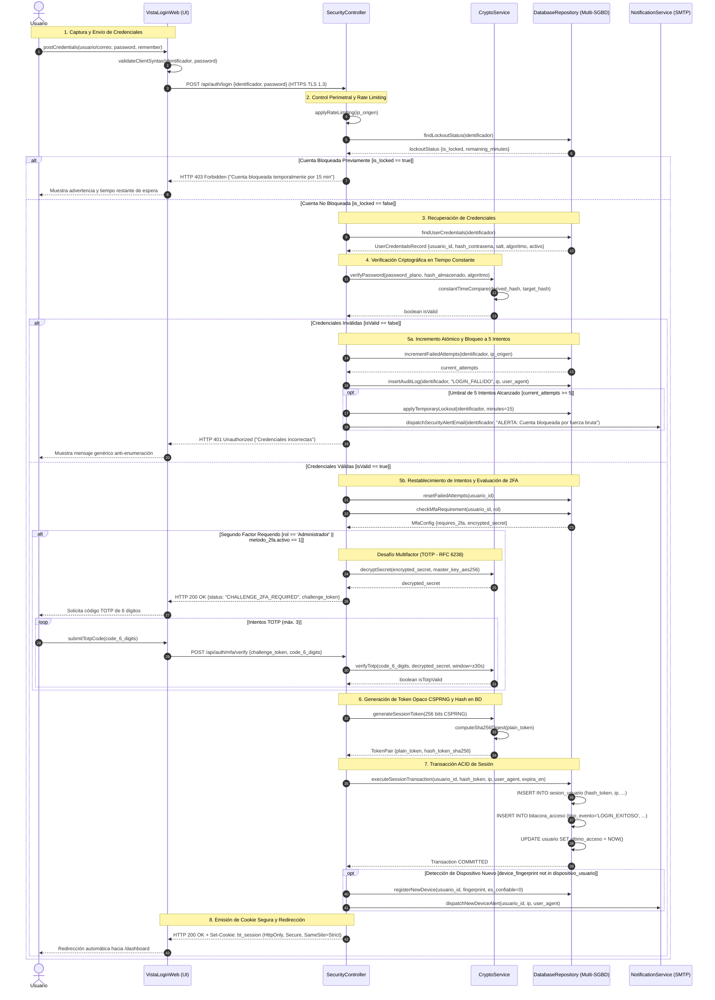
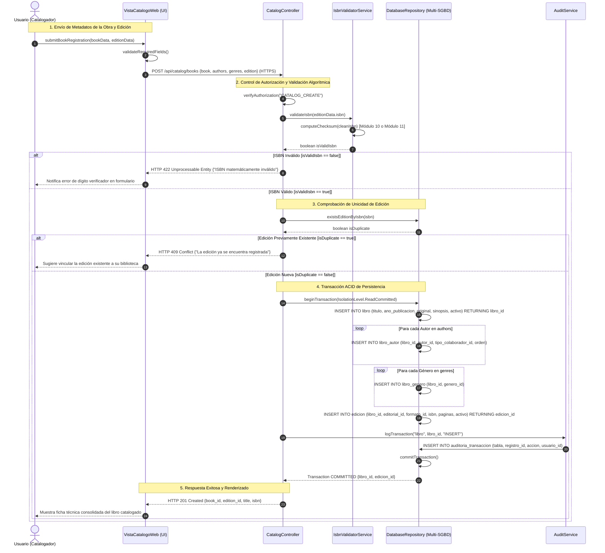
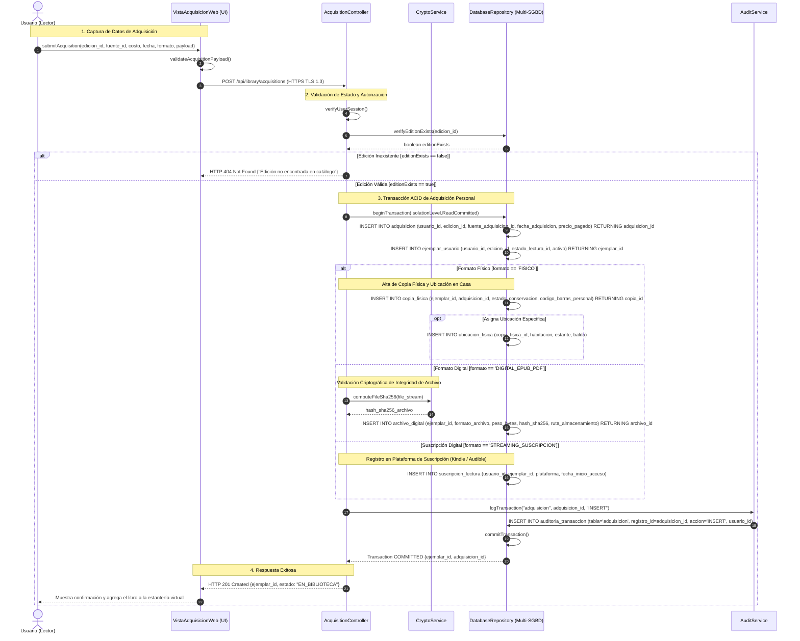
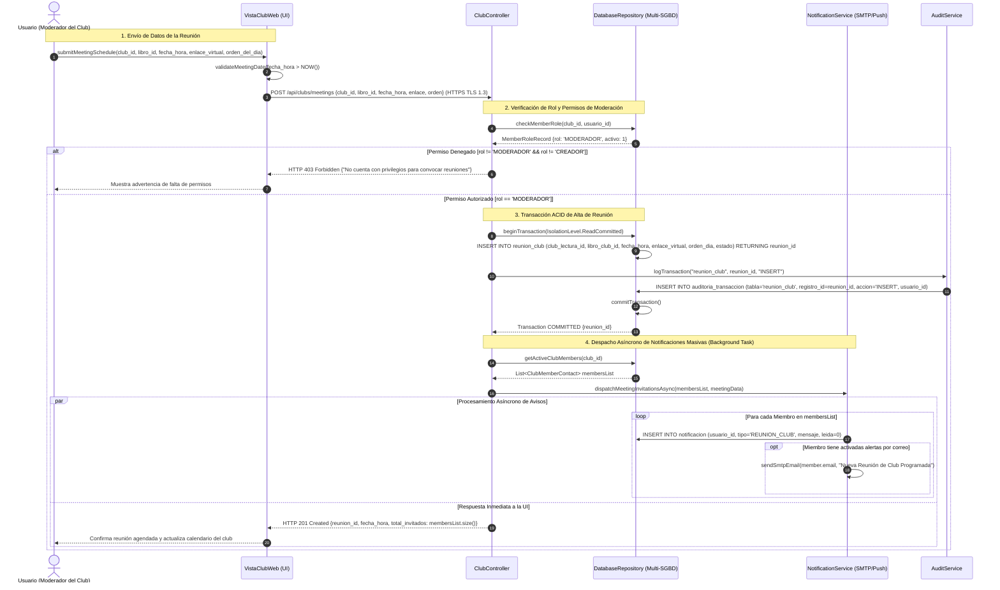

# 1.3 Modelado de Interacción y Secuencia Criptográfica

> **Proyecto Integrador Multidisciplinario V — TecNM / Instituto Tecnológico Superior de Monclova**  
> **Asignatura:** Análisis y Modelado de Sistemas de Información (AMSI — IFE-1005)  
> **Sistema:** *Book Tracker* — Plataforma Integral de Gestión de Lectura, Biblioteca Personal, Hábitos y Analítica  
> **Autores:** Estudiante A (Seguridad y Biblioteca · 50 tablas) · Estudiante B (Lectura, Hábitos y Social · 50 tablas)  
> **Capítulo de Memoria Técnica:** Capítulo II, Sección 2.4 (Modelos de Interacción y Secuencia)  
> **Criterio Evaluado:** Criterio 1.3 de la Rúbrica Oficial (25% de la ponderación total de AMSI)  
> 📄 **Documento de Entrega Oficial (Word Editable):** [1.3 Modelado de Interacción y Secuencia Criptográfica.docx](./1.3%20Modelado%20de%20Interacci%C3%B3n%20y%20Secuencia%20Criptogr%C3%A1fica.docx)

---

## 1. Fundamentos Metodológicos y Cumplimiento de la Rúbrica (AMSI 1.3)

El presente documento formaliza los **Modelos de Interacción y Diagramas de Secuencia** de *Book Tracker* bajo el estándar **UML 2.5**, respondiendo estrictamente a los requisitos del **Criterio 1.3 de la Rúbrica Oficial de Evaluación de AMSI (25% | Nivel Excelente - 100%)**:

1. **Separación Rigurosa de Capas Arquitectónicas:**
   * **Capa de Presentación / UI:** Vistas web y componentes móviles (`VistaLoginWeb`, `VistaCatalogoWeb`, `VistaAdquisicionWeb`, `VistaCronometroWeb`, `VistaClubWeb`).
   * **Capa de Control / Controladores:** Orquestadores de peticiones y autorización (`SecurityController`, `CatalogController`, `AcquisitionController`, `ReadingSessionController`, `ClubController`).
   * **Capa de Servicios de Negocio y Criptografía:** Algoritmos especializados y seguridad matemática (`CryptoService`, `IsbnValidatorService`, `MetricsCalculatorService`, `AuditService`).
   * **Capa de Persistencia Multi-SGBD:** Repositorios de datos relacionales ejecutando transacciones ACID sobre nodos **Microsoft SQL Server** y **PostgreSQL**.
   * **Servicios de Infraestructura Asíncrona:** Despachadores de eventos y mensajería (`NotificationService` SMTP/Push).
2. **Deslinde de Autores Equitativo (50/50):**
   * **Estudiante A:** Secuencia criptográfica formal del Login seguro con 2FA (obligatoria por rúbrica) y 2 transacciones maestras de biblioteca personal (Catalogación ISBN y Adquisición/Archivos Digitales).
   * **Estudiante B:** 2 transacciones críticas de hábitos, productividad y comunidad (Sesión de lectura con cronómetro y Convocatoria de reunión de club).
3. **Manejo Estricto de Fragmentos Combinados UML 2.5:**
   * Alternativas condicionales (`alt`), ejecuciones opcionales (`opt`), bucles controlados (`loop`) y procesamiento paralelo/asíncrono (`par`).

---

## 2. Diagrama de Secuencia 1: Proceso de Autenticación Segura (Login) y Protocolo Criptográfico
*Caso de Uso Obligatorio de la Rúbrica — Responsable: Estudiante A (Submódulo A3)*

El diagrama modela el intercambio sincrónico y asincrónico entre las cuatro capas para la validación de credenciales, mitigación de ataques de fuerza bruta (*rate limiting* y bloqueo de cuenta), derivación hash con salting en tiempo constante, desafío multifactor TOTP (RFC 6238), expedición de token de sesión opaco generado mediante CSPRNG y persistencia inmutable en la bitácora de auditoría.

### Catálogo Cronológico de Mensajes e Invocaciones del Login

| Paso | Origen → Destino | Signatura de Invocación | Tipo | Descripción Arquitectónica y Criptográfica |
| :---: | :--- | :--- | :---: | :--- |
| **1** | `Usuario` → `VistaLoginWeb` | `postCredentials(id, pass, rem)` | Síncrono | El usuario introduce credenciales en formulario HTTPS. |
| **2** | `VistaLoginWeb` → `VistaLoginWeb` | `validateClientSyntax(id, pass)` | Auto | Validación sintáctica en cliente para prevenir sobrecarga. |
| **3** | `VistaLoginWeb` → `SecurityController` | `POST /api/auth/login` | Síncrono | Envío de payload JSON por canal seguro TLS 1.3 con HSTS. |
| **4** | `SecurityController` → `SecurityController` | `applyRateLimiting(ip)` | Auto | Verificación de umbral de peticiones por segundo por IP. |
| **5** | `SecurityController` → `DatabaseRepository` | `findLockoutStatus(id)` | Síncrono | Consulta en tabla `bloqueo_cuenta` para verificar bloqueos activos. |
| **6** | `DatabaseRepository` → `SecurityController` | `lockoutStatus {is_locked}` | Retorno | Retorna si la cuenta tiene `bloqueado_hasta > CURRENT_TIMESTAMP`. |
| **7a** | `SecurityController` → `VistaLoginWeb` | `HTTP 403 Forbidden` | Retorno | **[alt: is_locked]** Aborta sin tocar hashes (protege CPU contra DoS). |
| **8** | `SecurityController` → `DatabaseRepository` | `findUserCredentials(id)` | Síncrono | Consulta entidades `usuario`, `credencial_usuario` y `rol`. |
| **9** | `DatabaseRepository` → `SecurityController` | `UserCredentialsRecord` | Retorno | Retorna hash Argon2id/bcrypt, sal, algoritmo y estado activo. |
| **10** | `SecurityController` → `CryptoService` | `verifyPassword(pass, hash, algo)` | Síncrono | Invocación al motor criptográfico seguro. |
| **11** | `CryptoService` → `CryptoService` | `constantTimeCompare()` | Auto | Comparación en tiempo constante para neutralizar *Timing Attacks*. |
| **12** | `CryptoService` → `SecurityController` | `boolean isValid` | Retorno | Retorna resultado de la evaluación criptográfica. |
| **13a**| `SecurityController` → `DatabaseRepository` | `incrementFailedAttempts(id)` | Síncrono | **[alt: isValid == false]** Actualización atómica de intentos fallidos. |
| **13b**| `SecurityController` → `DatabaseRepository` | `insertAuditLog('FALLIDO')` | Síncrono | Inserta evento inmutable en `bitacora_acceso` (RNF-B-06). |
| **13c**| `SecurityController` → `NotificationService` | `dispatchSecurityAlertEmail()` | Asíncrono | **[opt: intentos >= 5]** Bloquea cuenta por 15 min y despacha correo. |
| **13d**| `SecurityController` → `VistaLoginWeb` | `HTTP 401 Unauthorized` | Retorno | Mensaje genérico uniforme anti-enumeración de usuarios. |
| **14**| `SecurityController` → `DatabaseRepository` | `resetFailedAttempts(user_id)` | Síncrono | **[alt: isValid == true]** Restablece a 0 el contador en `bloqueo_cuenta`. |
| **15**| `SecurityController` → `DatabaseRepository` | `checkMfaRequirement(user_id)` | Síncrono | Comprueba si el rol es Administrador o tiene 2FA activo en `metodo_2fa`. |
| **16**| `DatabaseRepository` → `SecurityController` | `MfaConfig {requires_2fa}` | Retorno | Retorna configuración MFA y secreto cifrado en AES-256. |
| **17a**| `SecurityController` → `CryptoService` | `decryptSecret(aes256)` | Síncrono | **[alt: requires_2fa]** Descifra el secreto TOTP con clave maestra de entorno. |
| **17b**| `SecurityController` → `VistaLoginWeb` | `CHALLENGE_2FA_REQUIRED` | Retorno | Emite desafío temporal firmado (5 min) y solicita código de 6 dígitos. |
| **17c**| `SecurityController` → `CryptoService` | `verifyTotp(code, secret)` | Síncrono | Valida HMAC-SHA1 según RFC 6238 en ventana temporal ±30s. |
| **18**| `SecurityController` → `CryptoService` | `generateSessionToken(256 bits)`| Síncrono | Genera token aleatorio CSPRNG y calcula digest SHA-256 (`hash_token`). |
| **19**| `CryptoService` → `SecurityController` | `TokenPair {plain, hash}` | Retorno | Retorna token plano y hash `CHAR(64)` para persistencia. |
| **20**| `SecurityController` → `DatabaseRepository` | `executeSessionTransaction()` | Síncrono | Transacción ACID: `sesion_usuario` + `bitacora_acceso` + `usuario`. |
| **21**| `SecurityController` → `VistaLoginWeb` | `HTTP 200 OK + Cookie` | Retorno | Cookie de sesión protegida (`HttpOnly`, `Secure`, `SameSite=Strict`). |

---

## 3. Diagramas de Secuencia Transaccionales del Estudiante A
*Catálogo Bibliográfico y Biblioteca Personal (Submódulos A6 y A8)*

### 3.1 Diagrama de Secuencia 2: Catalogación de Obra y Edición con Validación de ISBN (CU-A-06)
Modela el desacoplamiento formal entre la obra literaria (`libro`) y sus ediciones comerciales (`edicion`), verificando la integridad matemática del algoritmo ISBN mediante dígito verificador ponderado y ejecutando una transacción ACID atómica sobre tablas maestras e intermedias N:M.

---

### 3.2 Diagrama de Secuencia 3: Adquisición de Ejemplar, Ubicación Física y Archivo Digital (CU-A-08)
Modela la incorporación de un ejemplar a la colección personal del usuario, distinguiendo si se trata de una copia física (asignando estantería del hogar) o de un archivo digital (ePub/PDF), validando la integridad del archivo mediante cálculo de hash SHA-256 en el servicio criptográfico para evitar redundancia y manipulación no autorizada.

---

## 4. Diagramas de Secuencia Transaccionales del Estudiante B
*Hábitos de Lectura, Métricas y Comunidad Social (Submódulos B1 y B8)*

### 4.1 Diagrama de Secuencia 4: Registrar y Concluir Sesión de Lectura Activa con Cronómetro (CU-B-01)
Modela el flujo completo de una sesión de lectura cronometrada en vivo: control de pausas, finalización con reporte de página alcanzada, cálculo matemático de velocidad de lectura (páginas por minuto) y actualización transaccional atómica del progreso del libro, hábitos diarios y racha continua de lectura.

```mermaid
sequenceDiagram
    autonumber
    actor U as Usuario (Lector)
    participant V as VistaCronometroWeb (UI)
    participant C as ReadingSessionController
    participant M as MetricsCalculatorService
    participant BD as DatabaseRepository (Multi-SGBD)
    participant A as AuditService

    Note over U,V: 1. Solicitud de Finalización de Sesión de Lectura
    U->>V: finishSession(ejemplar_id, pagina_final, pausas_array, lugar_lectura_id)
    V->>V: validatePageInput(pagina_final >= pagina_inicial)
    V->>C: POST /api/reading/sessions/complete {ejemplar_id, t_inicio, t_fin, pausas, pag_fin} (HTTPS)

    Note over C,BD: 2. Recuperación del Estado del Ejemplar
    C->>BD: getBookReadingProgress(usuario_id, ejemplar_id)
    BD-->>C: ProgressRecord {pagina_actual, total_paginas, racha_actual}

    Note over C,M: 3. Cálculo Especializado de Métricas de Productividad
    C->>M: calculateNetDuration(t_inicio, t_fin, pausas)
    M-->>C: net_minutes_duration
    C->>M: calculateReadingSpeed(paginas_leidas, net_minutes)
    M-->>C: pages_per_minute

    Note over C,BD: 4. Transacción ACID de Hábitos y Progreso
    C->>BD: beginTransaction(IsolationLevel.ReadCommitted)

    BD->>BD: INSERT INTO sesion_lectura (usuario_id, ejemplar_id, inicio, fin, minutos_netos, paginas_leidas, ppm) RETURNING sesion_id

    loop Para cada Pausa en pausas_array
        BD->>BD: INSERT INTO pausa_sesion_lectura (sesion_lectura_id, inicio_pausa, fin_pausa, motivo)
    end

    BD->>BD: UPDATE progreso_lectura SET pagina_actual = :pag_fin, porcentaje = (:pag_fin / :total_paginas)*100 WHERE ejemplar_id = :id

    BD->>BD: INSERT INTO registro_habito (usuario_id, fecha=TODAY, minutos_totales, paginas_totales) ON CONFLICT (usuario_id, fecha) DO UPDATE ...

    Note over C,BD: 5. Evaluación de Continuidad de Racha (Submódulo B4)
    BD->>BD: evaluateDailyReadingGoal(usuario_id, TODAY)
    BD-->>C: goalAchieved {boolean goal_met}

    opt Objetivo Diario Cumplido [goal_met == true]
        BD->>BD: UPDATE racha_lectura SET dias_consecutivos = dias_consecutivos + 1, fecha_ultimo_dia = TODAY WHERE usuario_id = :u_id
    end

    opt Lectura Concluida al 100% [pag_fin == total_paginas]
        BD->>BD: UPDATE ejemplar_usuario SET estado_lectura_id = 'LEIDO', fecha_terminado = NOW() WHERE ejemplar_id = :id
        BD->>BD: INSERT INTO logro_usuario (usuario_id, logro_id='LIBRO_TERMINADO', fecha=NOW())
    end

    C->>A: logTransaction("sesion_lectura", sesion_id, "INSERT")
    A->>BD: INSERT INTO auditoria_transaccion (tabla='sesion_lectura', registro_id=sesion_id, accion='INSERT', usuario_id)

    BD->>BD: commitTransaction()
    BD-->>C: Transaction COMMITTED {sesion_id, net_minutes, pages_per_minute, new_streak}

    Note over C,V: 6. Renderizado de Resumen Estadístico
    C-->>V: HTTP 201 Created {sesion_id, ppm, new_streak, progress_percentage}
    V-->>U: Presenta resumen visual de la sesión y animación de progreso
```

---

### 4.2 Diagrama de Secuencia 5: Convocatoria de Reunión de Club de Lectura con Notificación Asíncrona (CU-B-08)
Modela la planificación y publicación de una reunión periódica de debate de un club de lectura por parte de su moderador, asegurando la verificación de permisos en la comunidad, la persistencia de la agenda y enlace virtual en la base de datos relacional, y el despacho asíncrono no bloqueante de notificaciones a todos los miembros inscritos.

---

## 5. Matriz de Trazabilidad Transaccional Global

La siguiente matriz evidencia la correspondencia matemática y arquitectónica entre los diagramas de interacción modelados, los 18 submódulos funcionales de la Fase 1 (AMSI 1.1) y el modelo de datos relacional de 100 tablas (FBD):

| Secuencia UML | Autor Responsable | Submódulo Funcional | Tablas Relacionales Involucradas (FBD) | Requisitos Satisfechos (AMSI 1.1) |
| :--- | :---: | :--- | :--- | :--- |
| **1. Autenticación y Criptografía (Login)** | **Estudiante A** | **A3:** Sesiones y Auditoría de Acceso **A4:** Segundo Factor (2FA) | `usuario`, `credencial_usuario`, `bloqueo_cuenta`, `metodo_2fa`, `sesion_usuario`, `bitacora_acceso`, `dispositivo_usuario` | `RF-A-01`, `RF-A-03`, `RF-A-11`, `RF-A-12`, `RF-A-13`, `RF-A-17`, `RNF-A-01`, `RNF-A-02` |
| **2. Catalogación y Validación ISBN** | **Estudiante A** | **A6:** Catálogo Bibliográfico Maestro | `libro`, `edicion`, `autor`, `editorial`, `genero`, `libro_autor`, `libro_genero`, `auditoria_transaccion` | `RF-A-27`, `RF-A-28`, `RF-A-29`, `RF-A-30`, `RF-A-31`, `RNF-A-03` |
| **3. Adquisición y Archivo Digital** | **Estudiante A** | **A8:** Copias, Adquisiciones y Formatos Digitales | `adquisicion`, `fuente_adquisicion`, `ejemplar_usuario`, `copia_fisica`, `ubicacion_fisica`, `archivo_digital`, `suscripcion_lectura`, `auditoria_transaccion` | `RF-A-35`, `RF-A-36`, `RF-A-37`, `RF-A-38`, `RNF-A-01`, `RNF-B-06` |
| **4. Sesión de Lectura y Cronómetro** | **Estudiante B** | **B1:** Sesiones de Lectura y Cronómetro **B4:** Metas, Hábitos y Rachas | `sesion_lectura`, `pausa_sesion_lectura`, `progreso_lectura`, `registro_habito`, `meta_lectura`, `racha_lectura`, `logro_usuario`, `auditoria_transaccion` | `RF-B-01`, `RF-B-02`, `RF-B-03`, `RF-B-04`, `RF-B-18`, `RF-B-20`, `RF-B-29`, `RNF-B-01` |
| **5. Reunión de Club y Notificaciones** | **Estudiante B** | **B8:** Clubes de Lectura y Social **B5:** Recordatorios y Alertas | `club_lectura`, `miembro_club`, `libro_club`, `reunion_club`, `notificacion`, `auditoria_transaccion` | `RF-B-24`, `RF-B-25`, `RF-B-39`, `RF-B-40`, `RF-B-41`, `RF-B-42`, `RNF-B-02` |

---

## 6. Garantías de Ciberseguridad, Transaccionalidad ACID y Rendimiento

1. **Atomicidad e Integridad Referencial:** Todas las secuencias que modifican más de una tabla relacional operan bajo bloques transaccionales explícitos (`BEGIN TRANSACTION` ... `COMMIT`). Ante fallos de red o errores de validación, se ejecuta `ROLLBACK` automático garantizando cero tuplas huérfanas.
2. **Control de Concurrencia y Bloqueos:**
   * La sesión de login utiliza transacciones atómicas con aislamiento `Read Committed` para evitar contención en el contador de intentos fallidos.
   * La adquisición y asignación de ejemplares utiliza claves foráneas indexadas y restricciones de unicidad (`UNIQUE`) compuestas para prevenir duplicados de copias físicas o archivos digitales.
3. **Auditoría Forense Inmutable:** Cada operación de inserción o actualización crítica dispara una llamada al `AuditService`, persistiendo en `auditoria_transaccion` o `bitacora_acceso` la marca de tiempo precisa (`CURRENT_TIMESTAMP`), usuario responsable, dirección IP y el estado anterior y nuevo.
4. **Resistencia contra Ataques Criptográficos:**
   * Las comparaciones de contraseñas y digests se realizan en **tiempo constante** (`constantTimeCompare`), neutralizando ataques de temporización (*Side-Channel Timing Attacks*).
   * Los secretos TOTP se resguardan cifrados simétricamente mediante AES-256 en reposo, descifrándose exclusivamente en memoria volátil durante la ventana de evaluación de $\pm 30$ segundos.
   * Los tokens de sesión se transmiten bajo directivas estrictas de cookies (`HttpOnly`, `SameSite=Strict`, `Secure`), imposibilitando el robo por Cross-Site Scripting (XSS) o Cross-Site Request Forgery (CSRF).
