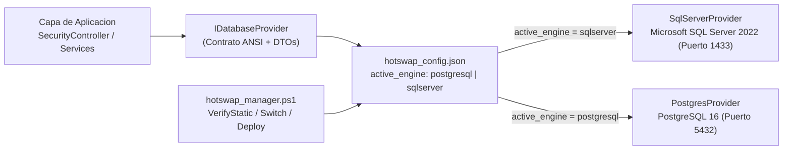

# 2.4 Implementación Multi-SGBD, Comparativa Técnica y Arquitectura *Hot-Swap*

> **Asignatura:** AEF-1031 — Fundamentos de Base de Datos (Criterio 2.4 · 35%)  
> **Capítulo de Memoria Técnica:** Capítulo V — Implementación Multi-SGBD y Comparativa Técnica  
> **Proyecto:** *Book Tracker* — 100 Tablas Normalizadas en BCNF (`1,339` columnas · `432` FKs · `1,854` registros semilla)  
> **Autores:** **Cesar Alexis De Luna Jiménez** (Estudiante A · 50 tablas) · **Gabriela Natalia De León Alvarez** (Estudiante B · 50 tablas)

---

## 1. Inventario de Entregables Ejecutables

| Artefacto | Microsoft SQL Server 2022 (`dbo`) | PostgreSQL 16 (`public`) |
| :--- | :--- | :--- |
| **01. Script DDL Maestro (100 tablas, 432 FKs, 140 índices)** | [01_ddl_book_tracker_sqlserver.sql](./scripts/sqlserver/01_ddl_book_tracker_sqlserver.sql) | [01_ddl_book_tracker_postgresql.sql](./scripts/postgresql/01_ddl_book_tracker_postgresql.sql) |
| **02. Script DML Datos Muestra (1,854 filas · ≥ 20 en 86 tablas, 0 texto claro)** | [02_dml_datos_muestra_sqlserver.sql](./scripts/sqlserver/02_dml_datos_muestra_sqlserver.sql) | [02_dml_datos_muestra_postgresql.sql](./scripts/postgresql/02_dml_datos_muestra_postgresql.sql) |
| **03. 10 Consultas de Álgebra Relacional** | [03_consultas_algebra_relacional_sqlserver.sql](./scripts/sqlserver/03_consultas_algebra_relacional_sqlserver.sql) | [03_consultas_algebra_relacional_postgresql.sql](./scripts/postgresql/03_consultas_algebra_relacional_postgresql.sql) |
| **04. Pruebas de Integridad y Criptografía** | [04_pruebas_criptografia_y_verificacion_sqlserver.sql](./scripts/sqlserver/04_pruebas_criptografia_y_verificacion_sqlserver.sql) | [04_pruebas_criptografia_y_verificacion_postgresql.sql](./scripts/postgresql/04_pruebas_criptografia_y_verificacion_postgresql.sql) |

---

## 2. Estudio Comparativo de Portabilidad y Sintaxis SQL (T-SQL vs. PL/pgSQL)

Para garantizar el intercambio transparente (*hot-swap*) entre el motor propietario (**Microsoft SQL Server 2022**) y el motor de software libre (**PostgreSQL 16**), el diseño físico conserva exactamente los mismos **100 nombres de tabla**, **1,339 nombres de columna** (`snake_case`) y **432 restricciones de llave foránea**, resolviendo sistemáticamente las diferencias de dialecto:

### 2.1 Matriz de Equivalencia de Tipos de Datos

| Dominio Lógico | Microsoft SQL Server 2022 | PostgreSQL 16 | Notas de Portabilidad |
| :--- | :--- | :--- | :--- |
| **PK Autoincremental** | `BIGINT IDENTITY(1,1)` | `BIGINT GENERATED ALWAYS AS IDENTITY` | Estándar SQL:2003 en PostgreSQL (superior a `SERIAL` en control de secuencia). |
| **Entero Largo / FK** | `BIGINT` | `BIGINT` | Paridad binaria de 64 bits. |
| **Entero Estándar** | `INT` | `INTEGER` | Paridad de 32 bits. |
| **Decimal Exacto** | `DECIMAL(p,s)` (`3,2`, `5,2`, `6,2`, `10,2`) | `NUMERIC(p,s)` | Precisión fija idéntica para precios, promedios y PPM. |
| **Cadenas Unicode** | `NVARCHAR(n)` | `VARCHAR(n)` | PostgreSQL usa UTF-8 nativo en `VARCHAR`; SQL Server requiere `NVARCHAR` + prefijo `N'...'`. |
| **Cadenas ASCII / Códigos** | `VARCHAR(n)` (`3`, `7`, `10`, `13`, `15`, `30`, `50`, `64`, `255`) | `VARCHAR(n)` | Usado para ISO, HEX, ISBN, hashes y `estatus`. |
| **Texto Largo** | `NVARCHAR(MAX)` | `TEXT` | Sinopsis, reseñas, avisos legales LFPDPPP y bitácora JSON/texto. |
| **Booleano** | `BIT` (`DEFAULT 0`/`1`) | `BOOLEAN` (`DEFAULT FALSE`/`TRUE`) | En consultas SQL se traduce `= 1` ↔ `= TRUE`. |
| **Fecha / Hora** | `DATE` / `TIME(0)` | `DATE` / `TIME(0)` | Paridad directa ANSI SQL. |
| **Fecha y Hora UTC** | `DATETIME2(0)` (`SYSUTCDATETIME()`) | `TIMESTAMPTZ` (`CURRENT_TIMESTAMP`) | Ambos almacenan UTC sin pérdida de zona horaria. |

### 2.2 Diferencias Críticas de Sintaxis DDL, DML y Funciones

| Aspecto Técnico | Microsoft SQL Server 2022 (T-SQL) | PostgreSQL 16 | Estrategia Aplicada en el Proyecto |
| :--- | :--- | :--- | :--- |
| **Delimitador de Lotes** | `GO` (separador de lotes de `sqlcmd`/SSMS) | `;` (sentencia estándar) | Scripts independientes por motor; `GO` solo en `scripts/sqlserver/`. |
| **Esquema por Defecto** | `dbo.<tabla>` | `public.<tabla>` (`SET search_path TO public;`) | Prefijo explícito `dbo.` en SQL Server y `search_path` en PostgreSQL. |
| **Longitud de Cadena en `CHECK`** | `LEN(moneda) = 3`, `LEN(hash_contrasena) >= 60` | `CHAR_LENGTH(moneda) = 3`, `CHAR_LENGTH(hash_contrasena) >= 60` | Traducción automática `LEN(` → `CHAR_LENGTH(` en DDL de PostgreSQL. |
| **Inserción con ID Explícito (DML)** | `SET IDENTITY_INSERT dbo.<t> ON; ... OFF;` | `INSERT INTO <t> (...) OVERRIDING SYSTEM VALUE VALUES (...);` + `setval(...)` | Sincronización final de las 100 secuencias en PostgreSQL mediante bloque `DO $$`. |
| **Cadenas Unicode en DML** | Prefijo `N'Texto con acentos'` | `'Texto con acentos'` (UTF-8 nativo) | El generador DML aplica `N'...'` solo en columnas `NVARCHAR` de SQL Server. |
| **Cascadas en Grafos Densos** | Error `1785` (*multiple cascade paths* hacia `usuario`) | Permitido pero riesgoso con baja lógica | **Todas las 432 FKs** usan `ON DELETE NO ACTION ON UPDATE NO ACTION`. |
| **Criptografía Nativa** | `HASHBYTES('SHA2_256', ...)` + `Argon2id`/`bcrypt` en app | Extensión `pgcrypto` (`crypt`, `gen_salt('bf', 12)`, `digest`) + app | En ambos motores se persisten únicamente hashes $\ge 60$ caracteres. |

---

## 3. Verificación Criptográfica y Cumplimiento de Seguridad

Conforme a los criterios **2.2** y **2.4** de la guía oficial y el Principio de Seguridad de la **LFPDPPP**:
1. **Cero contraseñas en texto claro:** Las tablas `credencial_usuario` y `historial_credencial` almacenan exclusivamente cadenas PHC válidas de **Argon2id** (`$argon2id$v=19$m=65536,t=3,p=4$...`, 97 caracteres) y **bcrypt** (`$2b$12$...`, 60 caracteres, factor de costo `12`).
2. **Tokens y secretos protegidos:** `sesion_usuario.hash_token`, `token_recuperacion.hash_token` y `codigo_respaldo_2fa.hash_codigo` almacenan resúmenes **SHA-256** de 64 dígitos hexadecimales; `metodo_2fa.secreto_cifrado` utiliza formato de texto cifrado `aes256gcm:...`.
3. **Scripts de comprobación:** Los scripts [04_pruebas_criptografia_y_verificacion_sqlserver.sql](./scripts/sqlserver/04_pruebas_criptografia_y_verificacion_sqlserver.sql) y [04_pruebas_criptografia_y_verificacion_postgresql.sql](./scripts/postgresql/04_pruebas_criptografia_y_verificacion_postgresql.sql) auditan automáticamente el conteo de las 100 tablas, las 432 FKs, el cumplimiento de longitud/prefijo de hashes y ejecutan una prueba viva de hashing dentro de una transacción reversible (`ROLLBACK`).

---

## 4. Arquitectura y Procedimiento de *Hot-Swap* entre SGBD

El intercambio en caliente (*hot-swap*) permite migrar la operación de *Book Tracker* de **Microsoft SQL Server 2022** a **PostgreSQL 16** (o viceversa) con impacto mínimo, gracias a la separación por capas definida en AMSI 1.4 (`IDatabaseProvider`) y a los artefactos de `FBD/scripts/hotswap/`:

### 4.1 Artefactos del Subsistema *Hot-Swap*
- **Configuración declarativa:** [hotswap_config.json](./scripts/hotswap/hotswap_config.json)
- **Contrato de adaptador:** [db_adapter_contract.md](./scripts/hotswap/db_adapter_contract.md)
- **Orquestador CLI:** [hotswap_manager.ps1](./scripts/hotswap/hotswap_manager.ps1)

### 4.2 Protocolo Operativo de Cambio en Caliente (*Switchover*)
1. **Validar paridad estática:** Ejecutar `.\FBD\scripts\hotswap\hotswap_manager.ps1 -Action VerifyStatic` para comprobar que ambos juegos de scripts mantienen exactamente 100 tablas, 432 FKs y el mismo volumen de registros semilla.
2. **Desplegar y verificar el motor destino:** Ejecutar `-Action Deploy -TargetEngine <motor>` para crear el esquema, cargar las 1,854 filas semilla y validar hashes criptográficos en el motor destino.
3. **Conmutar el proveedor activo:** Ejecutar `-Action Switch -TargetEngine <motor>` (actualiza `active_engine` en `hotswap_config.json` sin alterar entidades ni reglas de negocio).
4. **Comprobar consultas equivalentes:** Ejecutar `-Action RunQueries` para confirmar resultados equivalentes de las 10 consultas de Álgebra Relacional en el nuevo motor activo.
