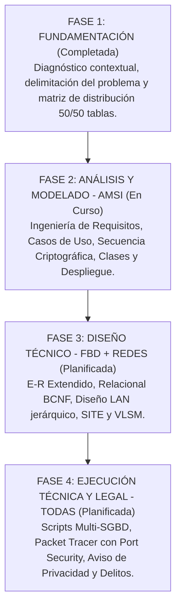

# Book Tracker — Proyecto Integrador Multidisciplinario

[](https://www.tecnm.mx)
[](#)
[](#)

Repositorio institucional del **Proyecto Integrador Terminal de Semestre** para la carrera de **Ingeniería Informática** del **Instituto Tecnológico Superior de Monclova (TecNM)**.

---

## 📖 Descripción del Sistema

**Book Tracker** es una plataforma integral corporativa para la gestión de lectura, biblioteca personal física y digital, registro de hábitos, analítica lectora y comunidad social. Está diseñada bajo una arquitectura orientada a objetos en 3 capas, un modelo relacional de **100 tablas** normalizadas en BCNF, infraestructura de red LAN corporativa de alta disponibilidad y estricto apego al marco jurídico mexicano (LFPDPPP y Código Penal Federal).

---

## 🏛️ Asignaturas Concurrentes del Proyecto

| Asignatura | Clave | Área de Competencia Evaluada |
| :--- | :---: | :--- |
| **Análisis y Modelado de Sistemas de Información (AMSI)** | `IFE-1005` | Análisis y modelado orientado a objetos (Requisitos, UML, Secuencia Criptográfica, Clases, Despliegue). |
| **Fundamentos de Base de Datos (FBD)** | `AEF-1031` | Modelo E-R Extendido, normalización (1FN a BCNF), 100 tablas, diccionario de datos, Álgebra Relacional e implementación Multi-SGBD (SQL Server + PostgreSQL/MariaDB). |
| **Redes de Computadoras (RC)** | `IFD-1020` | Red corporativa jerárquica (3 capas), subredes con VLSM/CIDR, cableado estructurado ANSI/TIA, diseño de SITE y seguridad en switches capa 2 (Port Security). |
| **Taller de Legislación Informática (TLI)** | `IFR-1024` | Aviso de Privacidad (LFPDPPP), Art. 16 Constitucional, contratos informáticos (SLA/EULA), registro INDAUTOR y matriz de prevención de delitos informáticos. |

---

## 👥 Matriz de Deslinde de Autoría (50/50)

Conforme a los criterios de acreditación del TecNM, cada integrante asume la autoría funcional y técnica del 50% del sistema (50 tablas y 9 submódulos cada uno):

| Integrante / Rol | Submódulos Responsables | No. Tablas | Enfoque Principal |
| :--- | :--- | :---: | :--- |
| **Estudiante A** | **A1 a A9:** Cuentas y credenciales, Roles y permisos, Sesiones y auditoría de acceso, Segundo factor (2FA) y dispositivos, Privacidad y ARCO, Catálogo bibliográfico, Biblioteca personal, Adquisiciones y préstamos, Importación de biblioteca. | **50** | **Seguridad, Control de Acceso y Biblioteca** |
| **Estudiante B** | **B1 a B9:** Sesiones de lectura con cronómetro, Notas y citas, Reseñas y calificaciones, Metas y hábitos, Recordatorios y notificaciones, Logros y niveles, Estadísticas y reportes, Clubes de lectura y social, Auditoría, sincronización y portabilidad. | **50** | **Lectura, Hábitos, Gamificación y Social** |

---

## 🗺️ Metodología y Fases del Proyecto

El avance del proyecto se rige por las 4 fases establecidas en el programa académico del TecNM:



### Detalle de las Etapas Hasta Ahora:

1. **[Fase 1: Fundamentación](./Fundamentación/README.md):**
   * Diagnóstico contextual y delimitación del sistema *Book Tracker*.
   * Justificación técnica, operativa y económica.
   * Matriz de deslinde y distribución equitativa de las **100 tablas** (50 Estudiante A / 50 Estudiante B).
   * Verificación de la proporción requerida por la rúbrica (< 25% catálogos simples y $\ge$ 75% tablas transaccionales/intermedias/maestras/bitácoras).
2. **[Fase 2: Análisis y Modelado (AMSI)](./AMSI/README.md):**
   * Catálogo codificado de Requisitos Funcionales (`RF-A-xx` / `RF-B-xx`) y No Funcionales (`RNF-A-xx` / `RNF-B-xx`) disponible en [1.1 Ingeniería de Requisitos.docx](./AMSI/1.1%20Ingenier%C3%ADa%20de%20Requisitos.docx).
   * Políticas de seguridad en tránsito (TLS 1.3), almacenamiento criptográfico (`bcrypt`/`Argon2`) y auditoría permanente (borrado lógico).
   * Modelado de Casos de Uso del negocio y caso obligatorio de **Login y Control de Sesión**.
   * Especificación de interacción criptográfica y arquitectura orientada a objetos en 3 capas.

---

## 📁 Estructura del Repositorio

```text
Proyecto Integrador/
│
├── .gitignore                                                              # Exclusión de temporales de Office (~$*) y SO
├── Proyecto Integrador V.pdf                                              # Especificación general y guía del proyecto
├── Rúbricas de Evaluación - Proyecto Integrador TecNM (AMSI, FBD, Redes, TLI).pdf  # Instrumento oficial por competencias
├── README.md                                                               # Documento maestro del repositorio
│
├── Fundamentación/                                                         # FASE 1: Fundamentación y Delimitación
│   ├── README.md                                                           # Memoria técnica de la Fase 1
│   ├── Lista_100_Tablas_y_Matriz_Deslinde.xlsx                             # Matriz de deslinde de las 100 tablas
│   └── plantilla_diccionario_datos.xlsx                                    # Plantilla estándar para el diccionario
│
└── AMSI/                                                                   # FASE 2: Análisis y Modelado (IFE-1005)
    ├── README.md                                                           # Memoria técnica de la Fase 2 (Rúbrica AMSI)
    └── 1.1 Ingeniería de Requisitos.docx                                    # Catálogo codificado de RF y RNF (18 submódulos)
```

---

## 📊 Parámetros Críticos de Acreditación (Rúbrica TecNM)

* **Volumen de Base de Datos:** 100 tablas normalizadas con PK y FK activas (cero tablas huérfanas).
* **Seguridad de Credenciales:** Prohibido texto claro; uso de hashing robusto (`bcrypt`/`Argon2`).
* **Multi-SGBD:** Scripts ejecutables compatibles con **Microsoft SQL Server** y gestor libre (**PostgreSQL / MariaDB**).
* **Infraestructura LAN:** Topología jerárquica de 3 capas, subnetting con VLSM y conmutadores con **Port Security** configurado.
* **Marco Legal Vigente:** Cumplimiento con LFPDPPP, trámite INDAUTOR y matriz de prevención conforme al Código Penal Federal (Arts. 211 bis 1 al 7).

